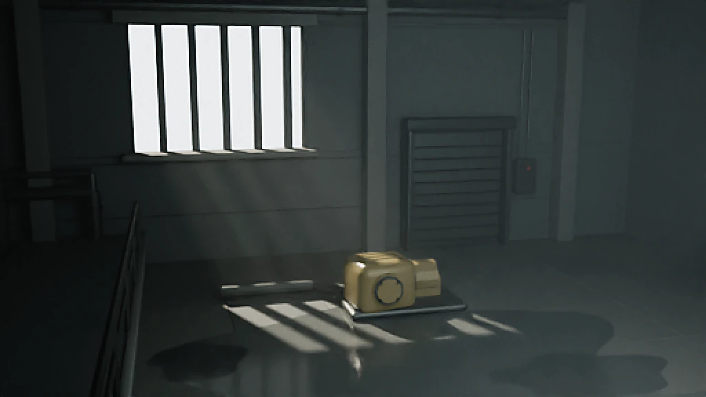

# 光影低保真 3D

**Atmospheric Lo-Fi 3D** 用简洁的三维体块和有限的画面细节交代空间，让光的方向、阴影的形状和表面的反光建立氛围。

- **轮廓。** 在玩家实际使用的机位摆清前景、主体和通道，再按观看距离选择低面数、体素或低分辨率渲染。缩到游戏画幅，主角、障碍和目标仍各有清楚的形状。
- **光路。** 给主光一个具体出处。栅窗漏下的光经过栏杆，在地面留下与栅条对应的影子。走廊尽头的一盏灯，可以只照亮出口和一小段路。给暗部留出能辨认地形的明度层次。
- **材质。** 把几种材质放进同一道侧光里。干墙保留宽而弱的亮面，潮地映出窗格，胶体弧面留一小片柔亮。优先调粗糙度与亮面大小，让材质在克制的用色里也能分清。

**委托示例**　“做一间黑灰色的低保真泄洪井。让栅窗的斜光扫过粗水泥，给史莱姆留一点湿亮，从俯视解谜机位也能看清目标格。” 胶体融合可用距离场光线步进（raymarching）。具体建模和着色方式按项目预算选取。

**实机核对**　用项目实帧在同机位、同尺寸下并排看前后两版。先隐去版本名，找一找主角和目标，再沿地面亮斑找光源。原速走过明暗交界，检查轮廓跳动、细纹闪烁，以及亮面或雾是否遮住操作信息。
